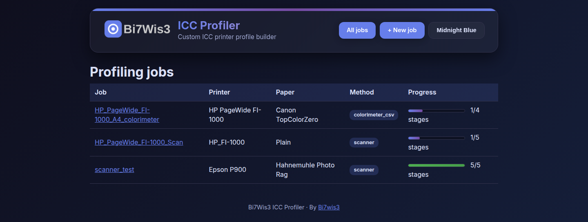

# ICC Profiler

Build custom ICC printer profiles by printing a generated test chart, measuring
the printed output, and feeding the result through [ArgyllCMS](https://argyllcms.com).
This project is orchestration/glue only — all color science is delegated to
ArgyllCMS's own command-line tools (`targen`, `printtarg`, `scanin`, `colprof`,
`profcheck`); nothing here reimplements profiling math.

A local web UI (and an equivalent CLI) walks you through: generating a patch
chart (optionally including specific colors you care about as real measured
patches), printing it, measuring the print, and building + verifying the
resulting `.icc` profile.



## Two measurement methods

| | **Scanner** | **Colorimeter CSV import** |
|---|---|---|
| Hardware | A flatbed/consumer scanner you likely already own | A real colorimeter/spectrophotometer not natively driven by ArgyllCMS (e.g. CHNSpec DS-173) |
| Extra prerequisite | A physical IT8.7 reference target + its vendor CGATS reference data | None |
| Effort per profile | One scan of the chart + one scan of the IT8 target | Measuring every chart patch individually by hand |
| Accuracy | Capped by scanner characterization quality | Meaningfully higher — real colorimetric measurement |

Pick per job. Both produce the same `.ti3` measurement format and feed the
same `colprof`/`profcheck` steps.

## Install

### ArgyllCMS

- **WSL / Ubuntu**: `sudo apt update && sudo apt install argyll` (pulls in
  `argyll-ref` for reference/chart-template data). Optionally
  `sudo apt install argyll-doc` for local HTML docs — read
  `doc/scanin.html` and `doc/Scenarios.html` before a real profiling run; a
  few exact flags in this project are marked unverified (see Limitations).
- **Native Windows**: download the official build from
  [argyllcms.com](https://argyllcms.com), extract it (e.g. to `C:\Argyll\`),
  and either add `C:\Argyll\bin` to PATH or set `"argyll": {"bin_dir": "C:\\Argyll\\bin"}`
  in your job config.

Run `python -m icc_profiler doctor` (or the "doctor" check before your first
job) to confirm all required tools resolve.

### This project

```
python -m venv .venv
source .venv/bin/activate   # or .venv\Scripts\activate on native Windows
pip install -r requirements.txt
```

## Usage

### CLI

```
python -m icc_profiler init-job --config configs/example_job_scanner.json
python -m icc_profiler run --job example_scanner_job
python -m icc_profiler status --job example_scanner_job
```

`run` executes every remaining stage and stops cleanly (exit 0, not an error)
whenever it's waiting on a human step — printing the chart, scanning it,
or measuring patches with a colorimeter. Re-run `run` once that's done to
continue.

### Web UI

```
uvicorn icc_profiler.webapp.app:app --reload
```

Or, to skip activating the venv yourself: `./start_profiler.sh` (runs the
same command via the project's `.venv`; any extra arguments are passed
through to uvicorn, e.g. `./start_profiler.sh --port 8080`).

Open `http://localhost:8000`. Create a job, pick a measurement method, add
any custom target colors, generate the chart, print it, upload your
scan(s)/CSV export, run the remaining stages, and view the results.

## A note on `output.quality`

`colprof`'s quality setting (`low`/`medium`/`high`/`ultra`) has a real
performance cliff: `high`/`ultra` were observed taking several minutes even
on a 15-21 patch synthetic test during development, apparently much worse
on data with many duplicate/near-duplicate points (e.g. a small or
degenerate patch set). `medium` is colprof's own documented default and
was fast in the same tests — the example configs and the web UI's job
creation form both default to it. Reach for `high`/`ultra` deliberately for
a final production profile once your patch set is large and realistic, not
as a default for every run.

## Limitations (read before trusting a profile)

- **Scanner path**: a flatbed/consumer scanner is not a colorimetric
  instrument. Its own color response must be corrected using the physical
  IT8 reference scan, and that scan plus the test-chart scan **must use
  identical scanner settings** (resolution, color mode, no auto-levels/
  auto-color, ideally the same session). Drift between the two degrades
  everything downstream. Even corrected, expect a lower accuracy ceiling
  than a real spectrophotometer.
- **Colorimeter CSV path**: meaningfully more accurate, and skips the IT8
  target entirely, but is NOT driven automatically by ArgyllCMS (checked
  directly against argyllcms.com's instrument list) — every patch is
  measured and named by hand, matched against the strip/row label
  ArgyllCMS actually prints next to each patch (e.g. "A14" — confirmed
  visually against real chart output), not any internal patch name. A
  mis-typed/misordered patch name will be caught at import (every printed
  label must have a matching, uniquely-named reading) but a *wrong* reading
  under a *correct* name will not be.
- Custom target colors are genuinely measured as chart patches (not just
  checked afterward), but aren't exempt from either method's accuracy
  ceiling.
- `verify` (`profcheck`) checks fit against the profile's own training
  data, not independent accuracy. A rigorous check would print/measure a
  second, held-out chart.
- The full command pipeline (`targen` → `printtarg` → `scanin` →
  `colprof` → `profcheck`, both measurement paths) was validated end to
  end against a real installed ArgyllCMS 3.1.0 using synthetic data —
  see comments in `icc_profiler/stages.py` for specifics confirmed along
  the way (e.g. `targen`'s real `-d` device-class codes, `printtarg`
  needing `-s`/`-t<dpi>` to produce a usable `.cht`/TIFF at all, `scanin`'s
  `-O` output-redirect only working in some modes, and the real
  `profcheck` summary-line format). What that synthetic testing could
  *not* validate is real-world accuracy or behavior with an actual
  printer/scanner/colorimeter — the first real run should still be treated
  as a shakedown.
- The colorimeter CSV column layout (`measurement.colorimeter_csv.column_map`)
  is a guess until checked against a real export file from your device.
